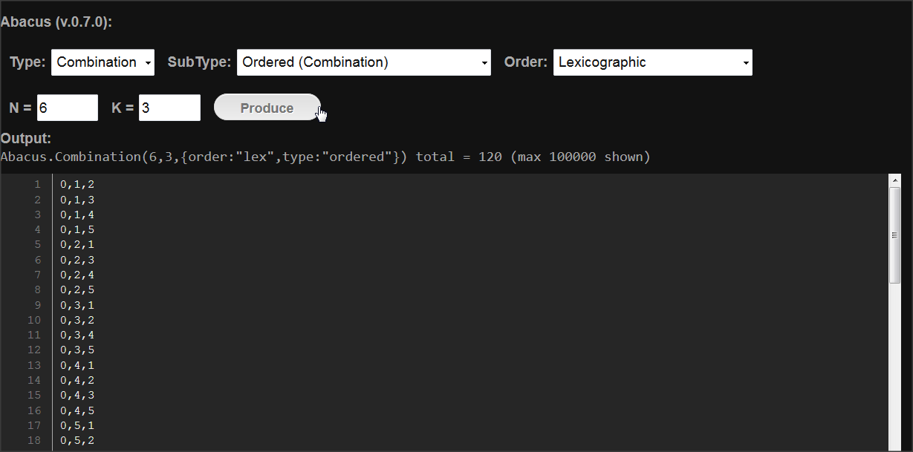
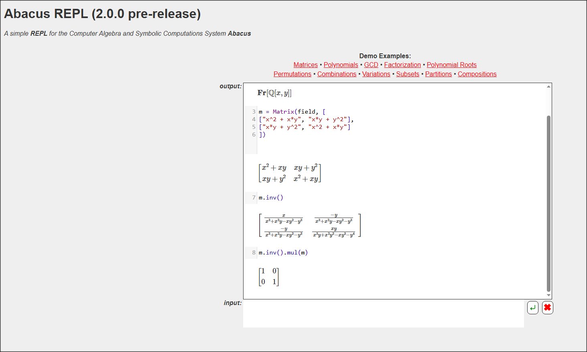

# Abacus

**Computer Algebra System** for Symbolic Computations for Combinatorics and Algebraic Number Theory for JavaScript

**version 2.0.0** almost complete (438 kB minified)

`Abacus` is a relatively small and versatile computer algebra and symbolic computation system containing methods and math utilities for fast combinatorial object computation and algebraic / number theoretic computation. It builds on, and extends, a deprecated previous project `Simulacra`.

### Contents

* [Live Playground Example](https://foo123.github.io/examples/abacus)
* [Online REPL](https://foo123.github.io/examples/abacus-repl)
* [Combinatorial and Number Theory Examples](/examples/README.md)
* [Features](#features)
* [Performance](#performance)
* [Credits and References](/references.md)
* [Example API](/api.md)
* [Todo](#todo)

### Features

**Supports:** (see: `test/test.bat`)

**Combinatorics:**
* `Tensor` (`test/tensors.js`)
* `Tuple` (`test/tuples.js`)
* `Permutation` (`test/permutations.js`, `test/permutations-bigint.js`)
* `CyclicPermutation` (`test/cyclic_permutations.js`)
* `MultisetPermutation` (`test/multiset_permutations.js`)
* `DerangementPermutation` (`test/derangements.js`)
* `InvolutionPermutation` (`test/involutions.js`) **supported order is LEX of swaps**
* `ConnectedPermutation` (`test/connected_permutations.js`) **supported order is LEX of cycle**
* `UnorderedCombination` / `Combination` (`test/combinations.js`)
* `OrderedCombination` / `Variation` / `kPermutation` (`test/ordered_combinations.js`)
* `UnorderedRepeatedCombination` / `RepeatedCombination` (`test/combinations_repeats.js`)
* `OrderedRepeatedCombination` / `RepeatedVariation` / `kTuple` (`test/ordered_combinations_repeats.js`)
* `Subset` (`test/subsets.js`)
* `Partition` (`test/partitions.js`) **partial support for COLEX**
* `Composition` (`test/compositions.js`) **partial support for COLEX**
* `RestrictedPartition` (`test/restricted_partitions.js`) **partial support for COLEX**
* `RestrictedComposition` (`test/restricted_compositions.js`) **partial support for COLEX**
* `SetPartition` (`test/setpartitions.js`) **rank/unrank methods missing, only LEX/REVLEX order**
* `RestrictedSetPartition` (`test/setpartitions.js`) **exactly K #parts, rank/unrank methods missing, only LEX/REVLEX order**
* `CatalanWord` (eg balanced parentheses) (`test/paren.js`) **rank/unrank methods missing**
* `LatinSquare` (`test/latin_squares.js`)
* `MagicSquare` (`test/magic_squares.js`)

* **algebraic composition** and **sequences** of combinatorial objects to construct new combinatorial objects (eg `all combinations` = `all permutations` **OF** `all unique combinations`, see `test/permutations_of_combinations.js` and `test/permutations_of_permutations.js`, `k-Derangements` = `(n,k) Combinations` **combined With** `(n-k) Derangements`, see `test/k-derangements.js` or `all subsets` = `(n,0)Combinations + (n,1)Combinations + .. + (n,n-1)Combinations + (n,n)Combinations`, see `test/combination_subsets.js`)
* custom and built-in **filters** which can select and generate any custom and complex combinatorial object from filtering other combinatorial objects as efficiently as possible (e.g see `test/filtered.js`, `test/filtered_partitions.js`). Also **algebraic / boolean composition of filters** (i.e `.NOT()`, `.AND()`, `.OR()` and so on..). **Note** that filtering should be **used with caution and only if no other method is currently possible** to generate the desired combinatorial object as **filtering is equivalent to exhaustive search** over the space of the original combinatorial object and as such can be an inefficient way to generate a combinatorial object (e.g see `test/filtered.js`). **Note2** with filtering applied some methods like `.total()`, `.hasNext()` still return data of the original object **not** the filtered object since that would require to pre-generate all the data and filter them afterwards instead of doing it one-by-one on each generation and would be impractical and unachievable for very large combinatorial objects, so be careful when using, for example, `.total()` with fitering applied
* **multiple (combined) iterator orderings &amp; traversals**: `lex`, `colex`, `random`, `reversed`, `reflected`, `minimal` (not implemented yet). For example: `"revlex"` (equivalent to `"lex,reversed"`), `"refcolex"`  (equivalent to `"colex,reflected"`), and so on..
* **arbitrary range** of combinatorial objects in a number of supported orderings (ie `lex`, `colex`, `random`,..) (and with filtering applied, if set). **Note** `unrank` methods have to be implemented for this feature to work
* **efficient and unbiased generation, (un)ranking, succession &amp; random methods** for supported combinatorial objects (see below)

**Symbolic Computations:**
* Numbers, eg `fibonacci`, `catalan`, `bell`, `factorial`, `partition`, `polygonal`, .. (`test/numbers.js`)
* Number Theory Functions, eg `gcd` / `xgcd` / `polygcd` / `polyxgcd` / `groebner`, `divisors`, `moebius`, `legendre`, `jacobi`, `isqrt`, `ikthroot`, .. (`test/number_theory.js`)
* `Integer`, `Rational`, `Complex` **supporting arbitrary precision arithmetic** (`test/integers.js`, `test/rationals.js`, `test/complex.js`)
* `Polynomial`, `MultiPolynomial` **univariate / multivariate with coefficients from a Ring/Field** (`test/polynomials.js`, `test/multivariate.js`)
* `RationalFunc` **Rational functions as fractions of multivariate polynomials** (`test/ratfuncs.js`)
* Algebraic `Rings` and `Fields` eg. `Ring.Z(), Ring.Q(), Ring.C(), Ring.Q("x","y"), ..` (`test/polynomials.js`, `test/multivariate.js`, `test/rings.js`)
* `Matrix` **with coefficients from a Ring/Field**  (`test/matrices.js`)
* `Expr` **general Symbolic Expressions** (`test/expressions.js`)
* `Series` **formal univariate / multivariate Power Series** (`test/power_series.js`)
* `Progression` (Infinite, Arithmetic, Geometric) (`test/progressions.js`)
* `PrimeSieve`, Primality Tests, Prime Factorisation (`test/primes.js`)
* Diophantine Linear Equations, Linear Congruences, Pythagorean n-Tuples (`test/diophantine.js`)
* Linear Systems, Polynomial Systems, Linear Inequalities (`test/linears.js`, `test/polys.js`, `test/lineqs.js`)

* `big-integer arithmetic`, `PRNG`s and other `math` utilities are **pluggable using external implementations**, making the lib very flexible especialy with respect to handling big-integers &amp; (pseudo-)random number generators (examples use the excellent [BigInteger.js](https://github.com/peterolson/BigInteger.js))

### Performance

* `first`/`last`, `random`, `rank`/`unrank` methods use **efficient linear** `O(n)` (or **log-linear** `O(nlgn)`) **time and space** algorithms (**note** a couple of rank/unrank methods are of `O(n^2)` or higher order)
* `random` methods are **statistically unbiased** (ie uniform sampling methods, see below as well)
* `successor` methods use **efficient CAT (ie constant amortized time) or Loopless (ie strictly constant time)** algorithms to generate next/prev object from current object (supporting multiple combinatorial orderings along the way, see above) (**note** a couple of methods are **linear time** algorithms because the lib does not use extra space to store information between successive runs and also support static random access to successors so any extra is computed at `run-time`, but can easily be made `CAT` or even `Loopless` by storing extra information, eg current index position)
* **avoid big-integer arithmetic and computational overhead** (except if explicit `ranking` / `unranking` is needed and objects are large)
* symbolic polynomials use efficient sparse representation
* number-theoretic/math computations support pluggable arithmetics (thus if used can compute with arbitrary precision arithmetic), algorithms implemented are efficient but not necessarily the most efficient version (theoretically) possible (eg default Euclidean algorithm for `gcd` used, although optimized), possible to implement even faster algorithms in future verions

**Note** that `Abacus` can generate **very large**, and also **randomized**, combinatorial objects **without ever using** biginteger arithmetic due to design and implementation, except if arbitrary `random`, `ranking` and `unranking` have to be used (see above)

### Todo

* apply built-in language `iterator`/`iterable` patterns (ES6 `iterator` protocol). Combinatorial objects additionaly support a `doubly-linked list`-like interface, i.e `prev`/`next` accessors **[DONE]**
* support exact `biginteger` arithmetic computations e.g large factorials **[DONE]**, arithmetic routines have been made **pluggable** and one can use an external implementation, see examples
* support **multiple combined custom iterator orderings**, i.e  `lex`, `colex`, `reversed`, `reflected`, `random` seamlessly and uniformly, both forward and backward **[DONE]**, `random` ordering may be optimized further
* support multiple combinatorial orderings (ie `lex`, `colex`, `reflex`, `refcolex`, `minimal`, ..) **directly in the successor methods**  instead of using post-transformations on object **[DONE]**
* implement **efficient successor methods** (preferably `CAT/Loopless` methods) to generate next/prev object from current object **[DONE]**
* implement **efficient ranking / unranking algorithms** and associated methods (preferably of `O(n)` or `O(nlgn)` complexity) for supported orderings **[DONE]**
* implement efficient `rank`/`unrank` methods for `Composition` &amp; `Partition` **[DONE]**
* implement efficient `rank`/`unrank` methods for `DerangementPermutation`  **[DONE]**
* implement efficient `rank`/`unrank` methods for `ConnectedPermutation` **[DONE]**
* implement efficient `rank`/`unrank` methods for `InvolutionPermutation` **[DONE]** (not very efficient)
* full support for `colex` ordering `Composition` &amp; `Partition` **[DONE PARTIALLY]**
* support `minimal`/`gray` ordering (and successor) for all supported combinatorial objects (TODO)
* support **unique and uniform random ordering traversals** for all combinatorial objects, so that the space of a combinatorial object can be traversed in **any random ordering uniquely and unbiasedly** (useful in some applications, eg backtracking) **[DONE]**, used as custom iterator ordering, may be optimized further
* make sure the `random()` methods **uniformly and unbiasedly sample the combinatorial object space** (methods use unbiased sampling algorithms, however results in certain cases might depend on [quality of PRNGs](http://www0.cs.ucl.ac.uk/staff/d.jones/GoodPracticeRNG.pdf)) **[DONE]**
* support algebraic composition/cascading of combinatorial objects to construct new combinatorial objects (eg `all combinations` = `all permutations` **OF** `all unique combinations`) **[DONE]**
* support generation of supported combinatorial objects with additional **user-defined patterns/templates of constraints** to satisfy e.g *"only combinatorial objects matching `'(n)(m)(1){2}(){3}(0)((n+1))((n+m)){4}'`"* pattern.. **[DONE]**
* implement `LatinSquare`, `MagicSquare` algorithms **[DONE]**
* add run-time/lazy custom and/or built-in filtering support (with support for filter composition as well) to generate and select custom and complex combinatorial objects from filtering other combinatorial objects as efficiently as possible **[DONE]**
* implement efficient primality tests and prime sieves **[DONE PARTIALLY]**
* implement efficient integer factorization algorithms **[DONE PARTIALLY]**
* implement more efficient integer algorithms (maybe fine-tuned if BigInteger Arithmetic is used) (eg `fibonacci`, `factorial`, ..) **[DONE PARTIALLY]**
* implement more efficient integer `GCD` algorithm **[DONE PARTIALLY]**
* implement `LU`,`QR`,`LDL` factorizations **[DONE]**
* implement `Rank` factorization` **[DONE]**
* implement `GINV` (Moore-Penrose Inverse) computation **[DONE]**
* implement `Hermite Normal Form`, `Smith Normal Form` **[DONE]**
* <del>implement numeric `EVD / SVD` computation</del>
* support general symbolic expressions and computations in `Expr` **[DONE]**
* support (formal) univariate and multivariate power series of symbolic expressions in `Series` **[DONE]**
* implement adequate and efficient simplification methods for symbolic expressions **[DONE PARTIALLY]**
* support basic analytic functions in symbolic expressions (eg. `exp`, `log`, `sin`, `cos`, ..) **[DONE]**
* support solutions of systems of **linear diophantine and linear congruence equations** (with one or many variables) **[DONE]**
* support general and least-squares solutions of systems of **arbitrary linear equations** **[DONE]**
* support solutions of systems of **linear inequalities** (with one or many variables) **[DONE]**
* support solutions of systems of **linear diophantine and linear congruence inequalities** (with one or many variables) (TODO)
* support all exact rational solutions of systems of **arbitrary multivariate polynomial equations** **[DONE]**
* support all exact solutions of systems of **arbitrary multivariate polynomial equations** **[DONE PARTIALLY]**
* implement optimized sparse representation and computations for polynomials instead of the inefficient dense representation **[DONE]**
* implement multivariate polynomials, multivariate operations, multivariate orderings **[DONE]**
* implement univariate polynomial factorization, rational root finding (`Kronecker` algorithm) **[DONE]**
* implement univariate polynomial exact root finding for solvable polynomials **[DONE]**
* implement univariate polynomial approximate root finding (`Aberth` algorithm) **[DONE]**
* implement multivariate polynomial factorization (recursive `Kronecker` algorithm) **[DONE]**
* implement multivariate polynomial approximate root finding (TODO)
* implement recursive multivariate polynomial `GCD` from univariate polynomial `GCD` **[DONE]**
* implement more efficient polynomial `GCD` algorithm (TODO)
* implement polynomial `Resultant`, `Discriminant` computations **[DONE]**
* implement `Groebner Basis` computations (`Buchberger` algorithm) **[DONE]**
* implement more efficient `Groebner Basis` computations (TODO)
* implement `LLL` algorithm (TODO)
* support generic algebraic Rings and Fields (including rings of polynomials and fraction fields of polynomials) **[DONE]**
* support algebraic sub-Rings and sub-Fields (eg **Q(y,z)(x)** with coefficients from the subring **Q(y,z)**) **[DONE]**
* support Quotient Rings/Fields, Algebraic Numbers and Field Extensions **[ALMOST DONE]**
* support *graph* combinatorial objects like `Graph`, `Grammar`,.. (TODO?) (for regular grammars and expressions see [RegexAnalyzer](https://github.com/foo123/RegexAnalyzer) for an example)

**see also:**

* [Abacus](https://github.com/foo123/Abacus) Computer Algebra and Symbolic Computation System for Combinatorics and Algebraic Number Theory for JavaScript
* [SciLite](https://github.com/foo123/SciLite) Scientific Computing Environment similar to Octave/Matlab/SciPy in pure JavaScript
* [TensorView](https://github.com/foo123/TensorView) view array data as multidimensional tensors of various shapes efficiently
* [FILTER.js](https://github.com/foo123/FILTER.js) Video and Image Processing and Computer Vision Library similar to OpenCV in pure JavaScript (browser and nodejs)
* [HAAR.js](https://github.com/foo123/HAAR.js) image feature detection based on Haar Cascades in JavaScript (Viola-Jones-Lienhart et al Algorithm)
* [HAARPHP](https://github.com/foo123/HAARPHP) image feature detection based on Haar Cascades in PHP (Viola-Jones-Lienhart et al Algorithm)
* [MOD3](https://github.com/foo123/MOD3) 3D Modifier Library in JavaScript
* [Geometrize](https://github.com/foo123/Geometrize) Computational Geometry and Rendering Library for JavaScript
* [Fuzzion](https://github.com/foo123/Fuzzion) a library of fuzzy / approximate string metrics for PHP, JavaScript, Python
* [Matchy](https://github.com/foo123/Matchy) a library of string matching algorithms for PHP, JavaScript, Python
* [Regex Analyzer/Composer](https://github.com/foo123/RegexAnalyzer) Regular Expression Analyzer and Composer for PHP, JavaScript, Python
* [PatternMatchingAlgorithms](https://github.com/foo123/PatternMatchingAlgorithms) library of Pattern Matching Algorithms in JavaScript using [Matchy](https://github.com/foo123/Matchy)
* [SortingAlgorithms](https://github.com/foo123/SortingAlgorithms) library of Sorting Algorithms in JavaScript
* [Xpresion](https://github.com/foo123/Xpresion) a simple and flexible eXpression parser engine (with custom functions and variables support), based on [GrammarTemplate](https://github.com/foo123/GrammarTemplate), for PHP, JavaScript, Python
* [GrammarTemplate](https://github.com/foo123/GrammarTemplate) grammar-based templating for PHP, JavaScript, Python
* [codemirror-grammar](https://github.com/foo123/codemirror-grammar) transform a formal grammar in JSON format into a syntax-highlight parser for CodeMirror editor
* [ace-grammar](https://github.com/foo123/ace-grammar) transform a formal grammar in JSON format into a syntax-highlight parser for ACE editor
* [prism-grammar](https://github.com/foo123/prism-grammar) transform a formal grammar in JSON format into a syntax-highlighter for Prism code highlighter
* [highlightjs-grammar](https://github.com/foo123/highlightjs-grammar) transform a formal grammar in JSON format into a syntax-highlight mode for Highlight.js code highlighter
* [syntaxhighlighter-grammar](https://github.com/foo123/syntaxhighlighter-grammar) transform a formal grammar in JSON format to a highlight brush for SyntaxHighlighter code highlighter
